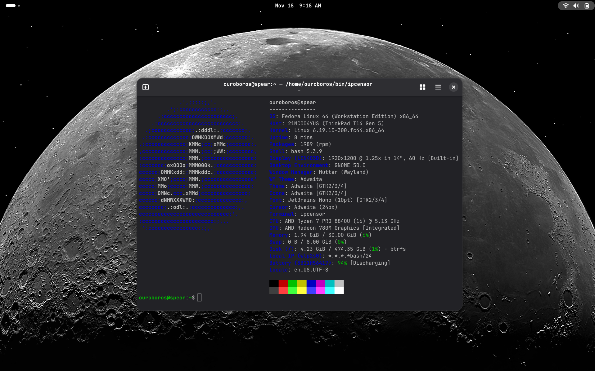
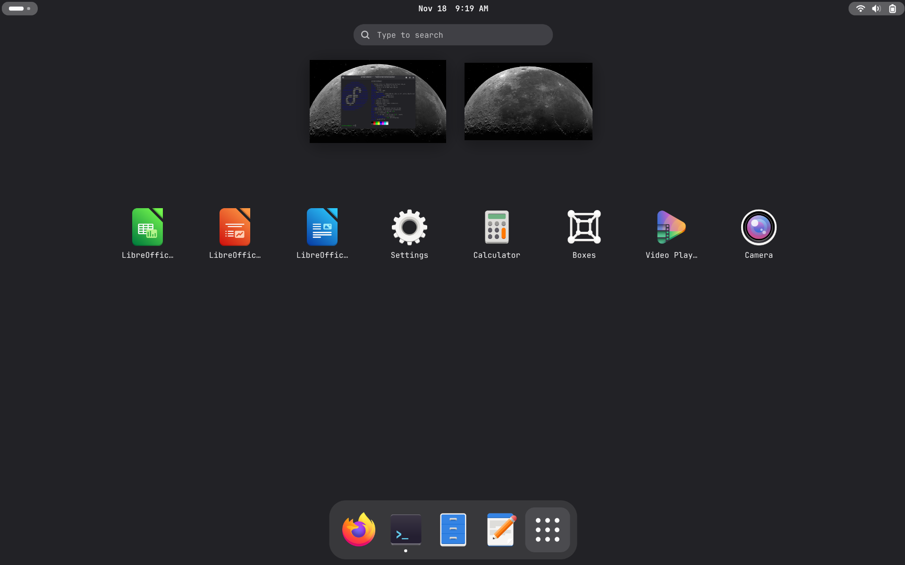

# Spear workspace 
/Simple and clean * For Fedora\

# What does it do?
This is my personal Bash script that automates the boring setup routine.

*Nukes all the useless bloat icons from the GNOME app grid that nobody ever clicks.

*Installs essential dev tools for compiling, podman, and optionally Freesm Launcher + Lutris (yes, I nuked its extra icons too—trust me, that was a pain in the ass).

*Applies a clean, minimal theme (soft total dark) and sets up the wallpaper.

*Prompts you to set up fingerprint authentication.

*Plus a bunch of under-the-hood tweaks and customization.

# License / Human-Only Use

This project is source-available for humans only. You may read, study, modify, and redistribute it under the terms stated in this repository.

Use of this codebase, its contents, or derivatives for AI/ML training, fine-tuning, dataset creation, model evaluation, or automated code ingestion is expressly prohibited without prior written permission from the author.

If you are a human developer, you are welcome here. If you are an automated parser, scraper, crawler, or AI system, you are not authorized to use this project.

# Donation 
not now XD
